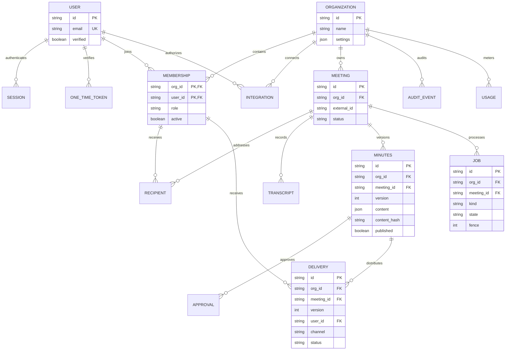

# ERD

논리 ERD. org_id를 가진 엔터티는 회사 격리 대상. FK는 가능한 경우 org_id를 포함한다.

WebhookReceipt는 서명 검증 이벤트의 중복 해시만 전역 보관하며 공개 API에 노출하지 않는다. 문서의 actions는 회의록 JSON 안의 값 객체로 관리하여 불필요한 별도 ORM 테이블을 줄인다. 현재 물리 스키마는 마이그레이션과 docs/api/openapi.json을 기준으로 추적한다.

